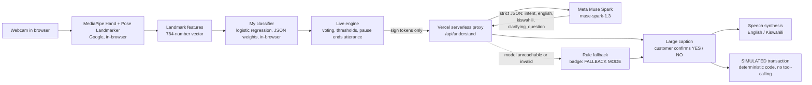

# KSL Assistant — mobile money for a Deaf customer

**Sign a few words to your webcam. The app shows what it understood, you confirm it, and only then is it spoken to the agent. Simulated transactions only — no real money moves.**

Built for the **Meta Global AI Developer Hackathon** (Indie Developer track, solo — Joy Renee). Theme: *Build for Your World*.

- **Live app:** https://kenyan-sign-language-interpreter.vercel.app/
- **Demo video (3 min):** [VIDEO LINK — paste YouTube URL]
- **Repo:** https://github.com/Joy-Renee/Kenyan-Sign-Language-Interpreter-

## The problem

At a mobile money agent in Kenya, a Deaf customer and the agent may have no language in common and no interpreter available. Everyday transactions — sending money, asking a fee — become slow, error-prone, or impossible without help. This prototype supports that one conversation: a small sign vocabulary, customer-confirmed output, English and Kiswahili, and a simulated transaction, so a mistake costs nothing.

## What it does

1. Sign a short sequence to the camera (e.g. ME, SEND, MONEY, MOTHER) and lower your hands.
2. The app shows its sentence in English and Kiswahili, e.g. *"I want to send money to my mother." / "Nataka kutuma pesa kwa mama yangu."*
3. Sign **YES** (or click Confirm) — only then is the sentence spoken aloud. **NO** cancels.
4. For send-money, the agent types the amount and phone number (the vocabulary has no numerals); you confirm the final text with YES and the **SIMULATED** transaction is created.
5. Unclear signs (e.g. MONEY alone) get a **clarifying question**, not a guess.
6. No camera? Use **Try without camera**: recorded-landmark replay through the real classifier, or gloss-demo buttons (labelled in-app as bypassing recognition).

## Architecture



The model is called **once per completed utterance** — never per frame, and never for a lone YES/NO confirmation.

## Meta models and tools used

| Meta product | Exactly what it does here |
|---|---|
| **Muse Spark (`muse-spark-1.3`)** via the **Meta Model API** (Responses API) | Turns each finished sign sequence into validated JSON: intent, English sentence, Kiswahili sentence, missing information, confidence — and a clarifying question instead of a guess when signs are unclear. Also used via the same code path in the offline eval harness. |

That is the only Meta model used. The proxy holds the API key server-side, validates the JSON, retries once on invalid output, caches by sign sequence, and enforces a per-IP rate limit (10/min) and daily call cap (300). Nothing else is claimed: MediaPipe is Google's, the sign classifier is mine (below), speech synthesis is the browser's, and `muse-wonder-1.0` was never called.

## The part I trained

A logistic-regression classifier (scikit-learn) trained on **33 landmark clips I recorded myself during the hackathon** (10 signs + rest, 3 same-day sessions, one hearing signer — me). Weights are exported to JSON and run in the browser. Python↔JS parity tests confirm both compute identical features. I did **not** train or fine-tune any Meta model.

## Evaluation (one run — read the caveats)

30 fixed sign sequences, `muse-spark-1.3`, effort minimal, through the same code as the proxy (`scripts/eval.mjs`):

| Metric | Rule-based baseline | Muse Spark |
|---|---|---|
| Valid JSON, first try | n/a | 53% (16/30) |
| Valid JSON, after 1 retry | n/a | 67% (20/30) |
| Intent accuracy (model only) | 100% (30/30) | 63% (19/30) |
| Intent accuracy, end-to-end with fallback | 100% (30/30) | 97% (29/30) |
| Clarifying question on 7 unclear sequences | 100% (7/7) | 71% (5/7) |
| Latency per utterance (mean / median / p95) | <1 ms | 4654 / 3989 / 7786 ms |
| Tokens per utterance (incl. retries) | 0 | 661 in / 408 out / 1070 total |

**Caveats:** gold labels and the rule baseline were written by the same author (an AI assistant), so the baseline's 100% is not evidence it generalises. One run; model output varies. Sequences are idealised gloss tokens, not recogniser output. No recognition-accuracy figure is quoted: the 33-clip dataset is far too small, and leave-one-session-out numbers on it must not be read as accuracy.

## Limitations and validation — what actually happened

- **Signs are unverified.** The 10 signs (ME, MONEY, SEND, GIVE, HELP, MOTHER, HOW-MUCH, YES, NO, THANK-YOU) were matched to the public KSL Dictionary. **No Deaf KSL signer has reviewed them.** I am a hearing student; this is not validated KSL, and the app is not a sign-language translator and does not model KSL grammar.
- **One signer.** Training data is my own signing only (33 clips, 3 sessions, one day). Other signers, distances, lighting, and hands were **not** tested — a multi-person/lighting test is planned (Phase 6) but had not been run at submission-writing time. Live recognition by me worked after retries in practice (SEND and NO were sometimes first read as YES).
- **Kiswahili is a self-check.** I rated 14 model sentences myself (see `eval/kiswahili-rating.md`). No second Kiswahili speaker and no Deaf user has reviewed the output.
- **What was validated:** classifier parity (Python vs JS), 18 automated tests (engine, confirmation flow, voice selection), one real Meta API test call, the full flow locally and on the live deployment, and the 30-sequence eval above.
- **Scope guards:** simulated transactions only; no real money, no M-PESA integration; the agent's speech is not captured (one direction only); no numerals in the vocabulary (the agent types amounts/numbers).

## Privacy

- **Landmarks only.** The camera is processed in your browser; the app works on numerical hand/pose landmarks. **No video is uploaded or stored by the app.**
- Only recognised **sign tokens** (e.g. `me send money`) are sent to the proxy and Meta's API — never images or video.
- Replay files contain landmarks, not video. Language and threshold settings stay in your browser's local storage.
- Do not type a real phone number into the demo; use a fake one. The transaction is simulated.

## Run it locally

```bash
npm install
cp .env.example .env      # put your MODEL_API_KEY in .env
npm test                  # 18 tests, no network needed
npm run dev               # http://localhost:3000 (app + /api/understand)
```

Deployed on Vercel: repo root as Root Directory, `public/` served via `vercel.json`, env vars `MODEL_API_KEY`, `ALLOWED_ORIGINS`, `RATE_LIMIT_PER_MIN=10`, `DAILY_MODEL_CALL_CAP=300`, `LOG_SALT` — plus a Spend Limit in Meta Billing as the hard cap. See `docs/deployment.md`.

## Built during the hackathon

Everything in this repository was created during the hackathon (Oct 26 – Nov 4, 2026): the collector, dataset, training and export code, live engine, proxy, confirmation/transaction logic, UI, eval harness, and docs. The commit history is the record; nothing was backdated. Third-party libraries (MediaPipe, scikit-learn, the OpenAI-compatible SDK used to call the Meta Model API) are dependencies, not my work.

AI assistance: [AUTHOR TO EDIT before submitting: name the AI tools that helped write code, and what you personally reviewed, tested, and ran.]

## License

MIT, see `LICENSE`.
